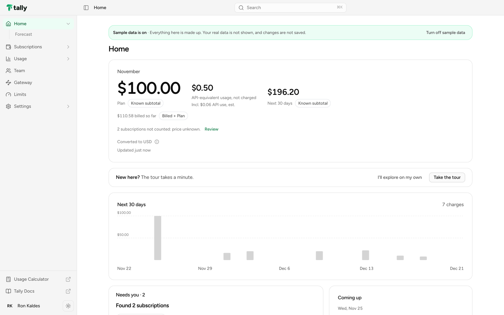
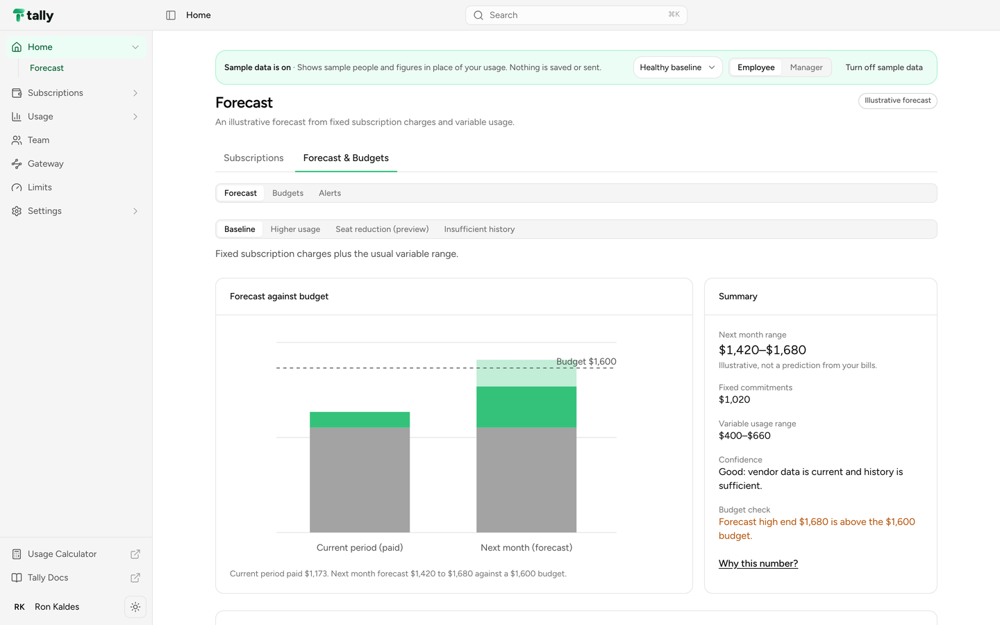
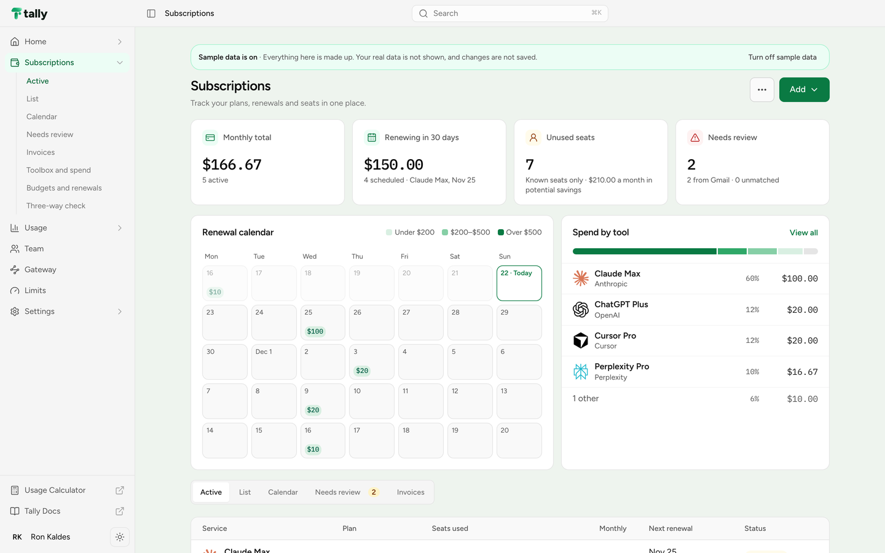
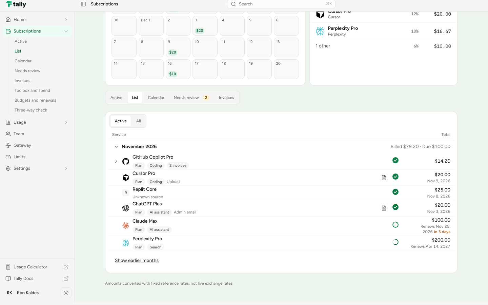
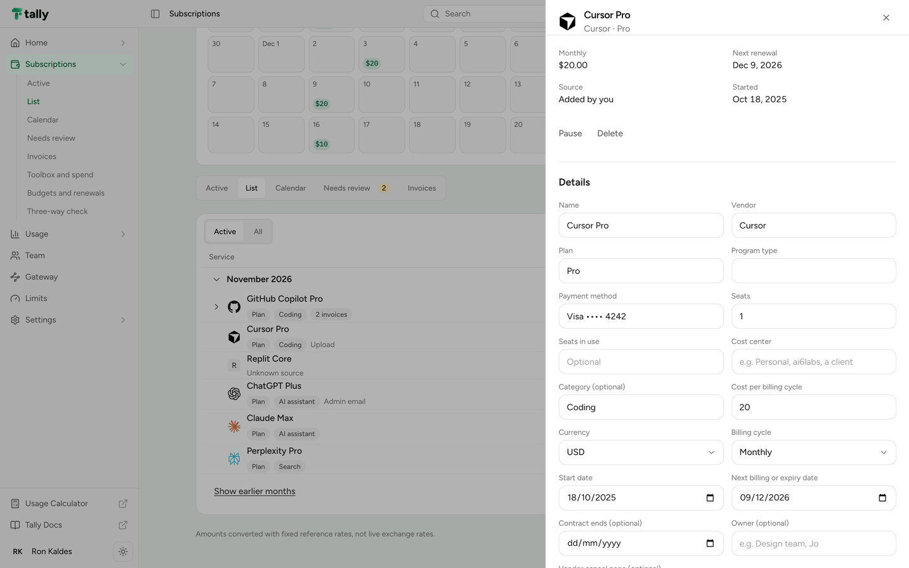
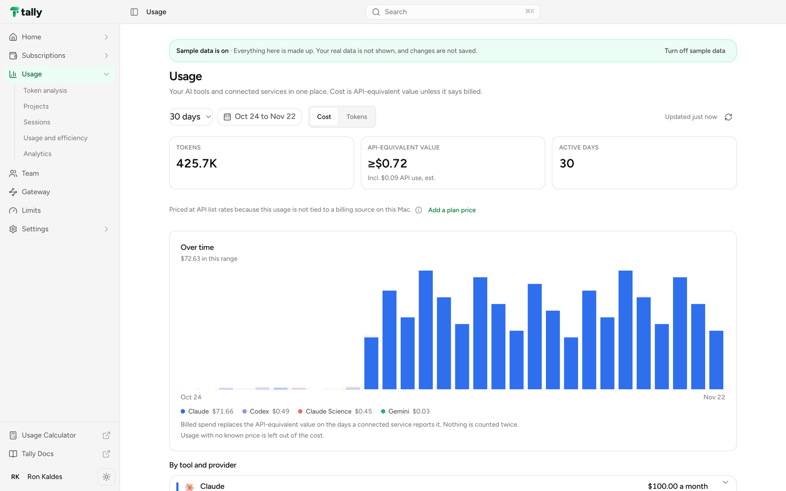
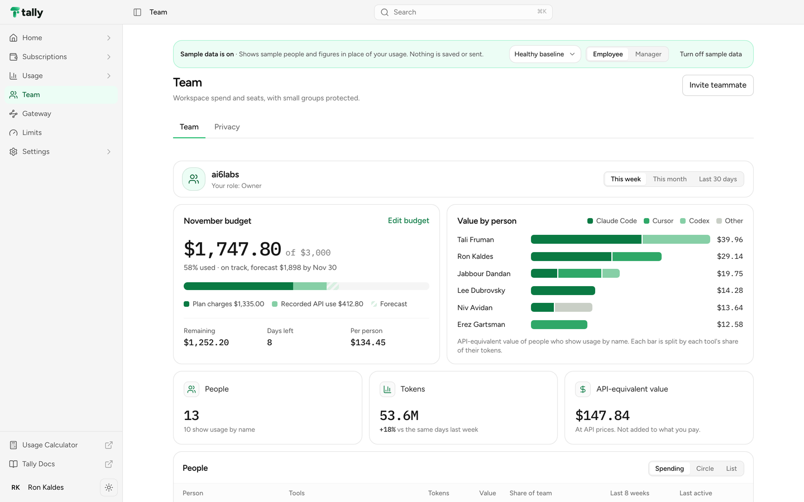
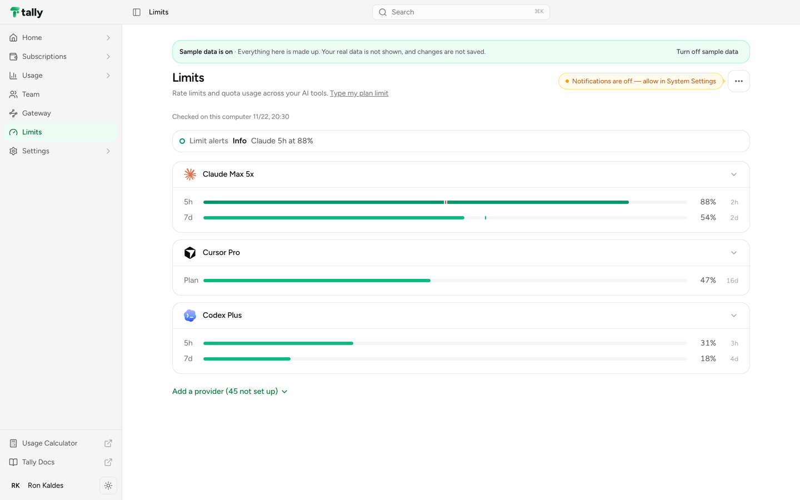

The sidebar has six items: **Home**, **Subscriptions**, **Usage**, **Team**, **Limits** and **Settings**, plus **Gateway** when you connect an LLM gateway. An item with an arrow opens to its subpages.

<Note>The pictures show the newest design with sample data; amounts are made up. This design, the expanding sidebar and **Team** always in the sidebar are newer than the 2.3.3 download: they are on app.tallyless.com now and come to the Mac app in its next build. In 2.3.3, **Team** appears in the sidebar once you are in a team. Some features still need the Mac app: Limits, statement import, boards, Skills and Analytics.</Note>

## Home

Home answers one question: what do you spend on AI this month?

- **This month:** one number, labelled **Plan** or **Billed**, with what was billed so far and the total for the **next 30 days**.
- **API-equivalent usage** is on its own line. It is what your token use would cost at public API prices, and it is never added to what you pay.
- **Next 30 days:** a chart of the charges coming up.
- **Needs you:** subscriptions found in Gmail, renewals in the next 7 days, and limits at Warning or Critical. With nothing to do, it reads "All good, nothing to do."
- **Coming up:** the next renewals by date.

<Frame></Frame>

**Forecast**, under Home, shows what is coming next month from your plan charges and recent usage. The picture is the sample-data version; see [Limits and budgets](/limits-and-budgets#forecast).

<Frame></Frame>

The menu bar shows the same month total as Home.

## Subscriptions

Everything you pay for. Four cards sit at the top: **Monthly total**, **Renewing in 30 days**, **Unused seats** and **Needs review**, then a **Renewal calendar** and **Spend by tool**.

<Frame></Frame>

Pick a view:

- **Active:** one row per service with its plan, seats used, monthly cost, next renewal and status.
- **List:** a monthly ledger. **Billed** and **Due** are shown apart, and several invoices from one service in a month fold into one row.
- **Calendar:** renewals by day.
- **Needs review:** card and statement charges that Tally could not match, and Gmail finds waiting for you.
- **Invoices:** PDFs from Gmail receipts, by month or by service. See [Invoices](/invoices).

<Frame></Frame>

One **Add** menu adds a subscription by hand, from Gmail, or from a statement CSV. Nothing is added until you choose to.

Click a row to open its side panel: edit it, pause it (a paused plan leaves the month total), delete it, and see its details.

<Frame></Frame>

The subpages **Toolbox and spend**, **Budgets and renewals** and **Three-way check** are boards that combine these figures.

## Usage

Pick a range (presets or your own dates) and **Cost** or **Tokens**. Usage shows tokens, API-equivalent value and active days, a chart over time, and one card per tool or provider that opens to its models, projects and billed splits.

When a connected service reports billed spend for a day, it replaces the estimate for that tool on that day, so nothing is counted twice. Usage with no known price is left out of the cost.

<Frame></Frame>

Subpages: **Token analysis**, **Projects** (names stay on your Mac), **Sessions**, **Usage and efficiency** and **Analytics**.

## Team

The team's budget, who uses what, and each person's panel. See [Team](/team).

<Frame></Frame>

## Limits

One card per plan, closest to its limit first, with each limit window (for example 5 hours and 7 days) and

the level of the highest alert threshold it has crossed. With the default thresholds (80% and 95%), a limit is OK below 80%, at **Info** from 80% and **Critical** from 95%. A 85%–94% threshold you add reads **Warning**.

<Frame></Frame>

See [Limits and budgets](/limits-and-budgets).

## Settings

Settings opens to **Connections**, **Privacy**, **Account**, **Menu Bar & Widgets**, **Skills** and **Service Status** in the sidebar.

| Section | What it holds |
|---|---|
| **Email** | Your Gmail connection: rescan or disconnect. |
| **Connections** | One place to connect everything, in four groups. **Found on this Mac**: the AI tools Tally found. **Plans and limits**: keys for plan and limit providers. **Billing**: admin keys for Anthropic, OpenAI and OpenRouter, so API spend is counted. **Gateways**: your LLM gateway connection. See [Connecting sources](/connecting-sources) and [Connect an LLM gateway](/gateways). |
| **Alerts** | Limit alerts, quiet hours, the monthly budget and how limits show. |
| **Account** | Your sign-in and account details. |
| **AI agents** | Connections so Claude can read your Tally cloud. See [Connect an AI agent](/ai-agents). |
| **Privacy** | What Tally reads, your data and the access log. See [Privacy](/privacy). |
| **Appearance** | Theme (Light, Dark or System), language, currency and number format. |
| **Local data** | **Run setup again**, **Erase captured data**, saved invoices, and export or import of your data. |
| **Advanced** | Skills, Menu bar and widgets, and Diagnostics. |
