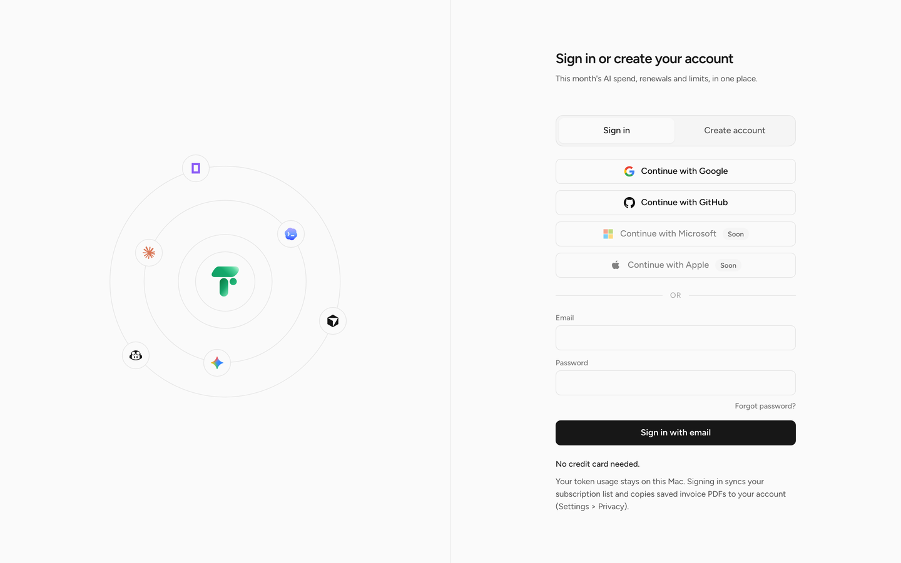
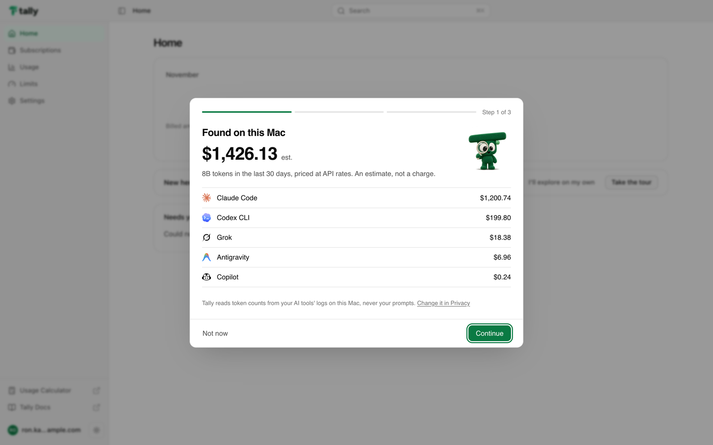
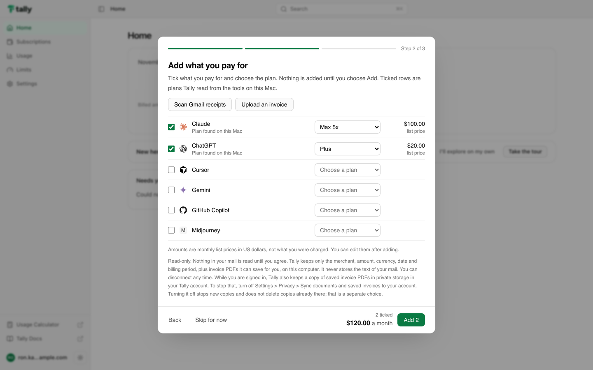
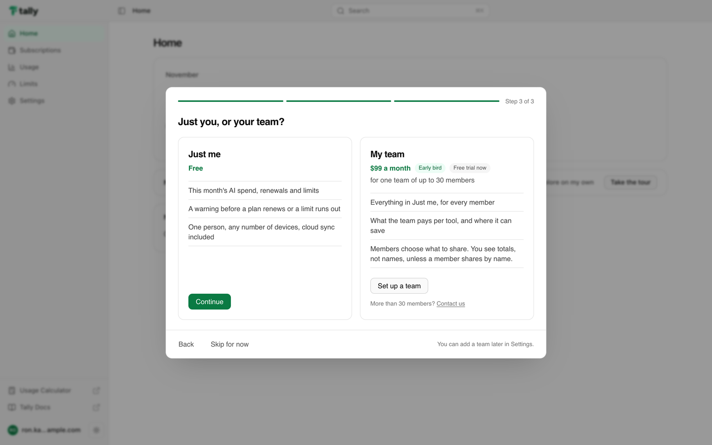
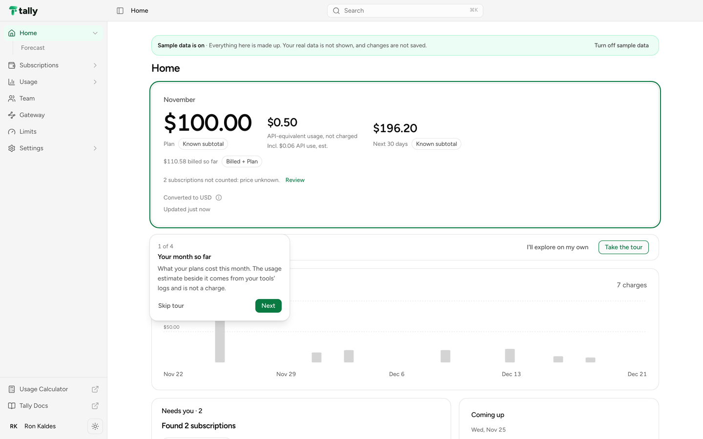

## 1. Sign in

Tally opens on a sign-in screen. You need to sign in or create an account before Tally shows anything, and no credit card is needed. **Sign in** and **Create account** sit side by side. Choose Google or GitHub, or use your email.

- Your token usage stays on your Mac unless you turn on **Sync usage**. Signing in syncs your subscription list and copies approved saved invoice PDFs to your account; turn off the subscription sync in Settings > Account and the invoice copy in Settings > Privacy.
- A saved sign-in keeps working when you are offline.
- If you sign out, Tally returns to the sign-in screen. Signing out stops syncing; copies already in your account stay until you delete them.

If you sign in with Google, a browser tab opens. When it shows "You're signed in. Return to Tally; you can close this tab.", go back to Tally.

<Frame></Frame>

## 2. Setup step 1 of 3: Found on this Mac

Tally reads the logs your AI tools leave on this Mac and shows what it found. The big number is an estimate of the last 30 days at API prices; it is not a charge. Tally reads token counts only, never your prompts.

Choose **Continue**, or **Not now** to go to Home.

<Frame></Frame>

## 3. Setup step 2 of 3: Add what you pay for

1. Tick each plan you pay for and pick its plan. Plans Tally read from the tools on this Mac are ticked already.
2. Optional: choose **Scan Gmail receipts** to find subscriptions in your mail, or **Upload an invoice**.
3. Choose **Add N** to save the ticked rows. Nothing is added until you choose Add. **Skip for now** moves on without adding.

Amounts are monthly list prices in US dollars; you can edit them later.

<Frame></Frame>

### What Gmail finds

The Gmail scan is read-only and checks the last 90 days of receipts first. Receipt fields stay on your Mac; attached invoice PDFs are saved here too, and while you are signed in copies of approved PDFs go to your Tally account unless you turn that off in [Privacy](/privacy). On Home, the scan card shows what it found, for example **Found 6 subscriptions · Add 5 · Review 1**. Nothing is added without your click. Background rescans run while the local service is running. See [Find subscriptions in Gmail](/gmail-scan) for scan timing and coverage.

## 4. Setup step 3 of 3: Just you, or your team?

- **Just me:** use Tally on your own. It is free.
- **My team:** finish setup and open the create-team screen. See [Team](/team).
- **Skip for now** also finishes setup.

<Frame></Frame>

## 5. Take the tour

Home shows **New here? The tour takes a minute.** Choose **Take the tour** for four stops: your month so far, what needs you, Subscriptions and Limits. Choose **I'll explore on my own** to hide it.

<Frame></Frame>

Scans run while Tally's local service is running. Recent receipts are checked before older history, so results can still be incomplete while the scan continues. See [Find subscriptions in Gmail](/gmail-scan) for progress, saved PDFs and review guidance.

## Run setup again

Open **Settings**, then **Local data**, then **Run setup again**. Your data is kept.

For downloading and installing the Mac app, see [Install Tally](/install).
