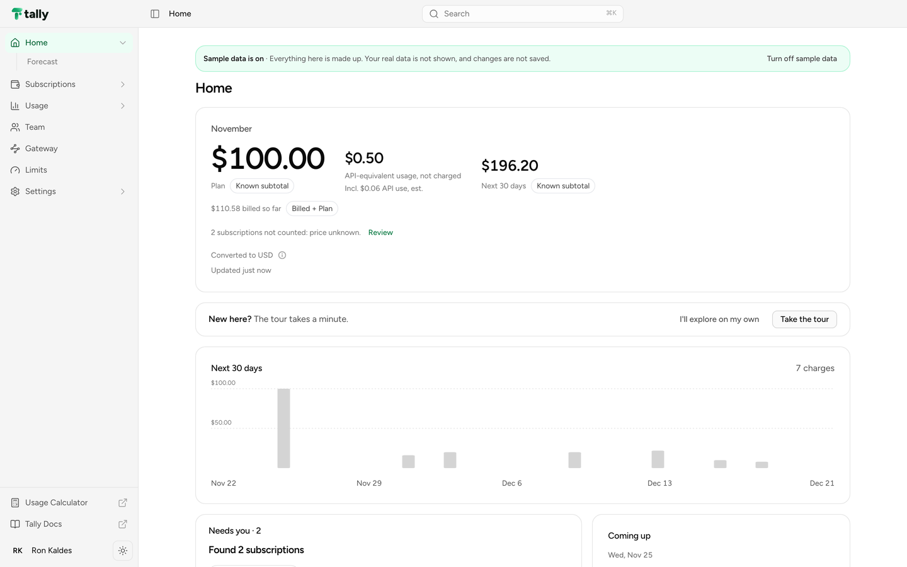

Tally is a Mac app that shows what you spend on AI this month: one number, without hunting. It reads the usage your AI tools, such as Claude Code, Codex, Cursor and Gemini CLI, already write on your Mac, and combines it with your subscriptions and API spend.

Tally keeps token counts, never prompts or conversation text. Your usage data stays on your Mac unless you turn on **Sync usage**.

## What you see

Tally has six screens:

- **Home:** this month's number, the next 30 days, and a **Needs you** list of things to act on.
- **Subscriptions:** every plan you pay for, with renewals, seats, a monthly ledger, Needs review and Invoices.
- **Usage:** tokens and API-equivalent value by tool and provider, over any range.
- **Team:** the team's budget, value by person, and each person's panel, by name only for those who opt in.
- **Limits:** how close each plan is to its limit.
- **Settings:** connections, privacy, account, menu bar and widgets, and your local data.

<Frame></Frame>

The picture shows the newest design, which is on app.tallyless.com now and comes to the Mac app after 2.3.3. See [The six screens](/dashboard) for details.

## Where to start

1. [Install Tally](/install) on your Mac.
2. [Sign in and finish first-run setup](/first-run). Setup is three short steps.
3. [Connect your sources](/connecting-sources) if you want API spend or Gmail receipts counted.

Tally is for macOS only. The Windows and Linux apps are paused.
