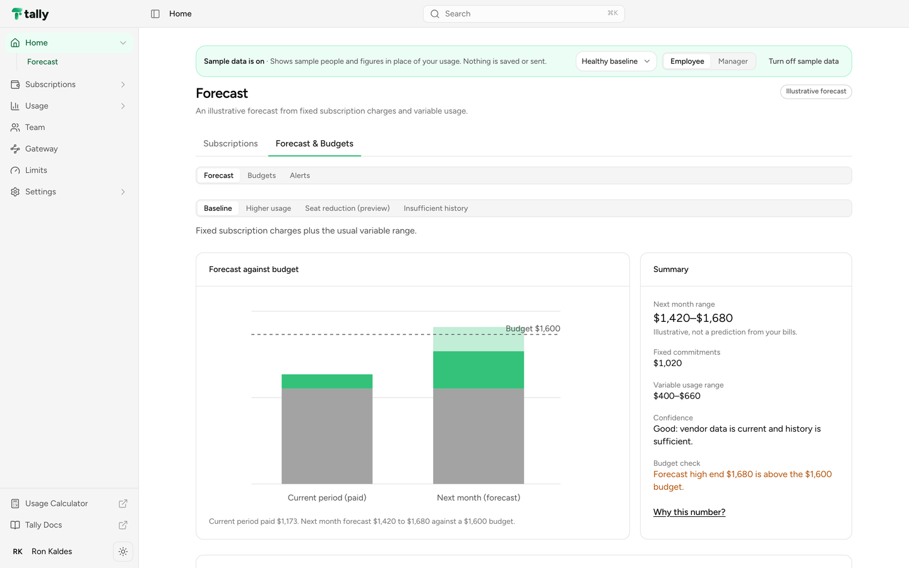

## Limits

The **Limits** screen shows one card per limit, closest to its limit first. Tally reads limits for 20 providers, from each provider's own service. Only the providers you use are shown.

Each card shows the level of the highest alert threshold its usage has crossed. The default thresholds are 80% and 95%: below 80% a limit is OK, from 80% it is at **Info**, and from 95% at **Critical**. You can add or change thresholds; a threshold's level is fixed by its percent:

| Threshold | Level |
|---|---|
| below 85% | **Info** |
| 85% to 94% | **Warning** |
| 95% and up | **Critical** |

Limits at Warning or Critical also appear under **Needs you** on Home.

- **Add a provider:** sets up a provider that is not connected yet. A key you save here is tested with one read first, and is saved only if the read works.
- **More providers:** open **Settings**, then **Connections**, and look under **Plans and limits** to connect a provider with an API key, or to add a second account. See [Connecting sources](/connecting-sources#connect-a-plan-or-limit-provider).
- **Connect:** some tools, such as Cursor, keep their sign-in encrypted. Choose **Connect** and sign in on the provider's website. Your sign-in stays on this Mac.
- **Not reported** or **Stale:** Tally has no fresh reading from that provider. It keeps the last good reading, so a provider that times out shows its last known bar instead of an error.

Limit checks need an internet connection.

## Limit alerts

Open **Settings**, then **Alerts**:

- **Limit alerts** sends a Mac notification when a limit crosses your thresholds. You get one alert per threshold per reset window.
- **Quiet hours** holds alerts between the times you choose. You decide whether held alerts are sent afterwards or skipped.
- **Muted sources** never send alerts.
- **Send a test** sends one notification now, so you can check that notifications are allowed.

## Monthly budget

Set a **Total monthly budget** in **Settings**, then **Alerts**. It counts plan charges and usage recorded as API key use: today that is Claude through the Anthropic API, and tools that report their own cost. Usage of other tools, such as Codex, Cursor or Gemini on a plan, adds nothing to it. Set it to 0 for no budget.

## Forecast

Choose **Forecast** under **Home**. It shows what is coming next month from your plan charges and your recent usage. Plan charges and API-equivalent usage are separate figures and are never added together.

<Note>The picture is the sample-data version. Its scenario buttons, **Why this number?** and the **Budgets** and **Alerts** tabs appear only with sample data on; your own forecast does not have them yet. Forecast under Home is newer than the 2.3.3 download: it is on app.tallyless.com now and comes to the Mac app in its next build.</Note>

<Frame></Frame>

Home also shows this month's plan charges and the next 30 days; estimated usage is never added to what you are charged.
