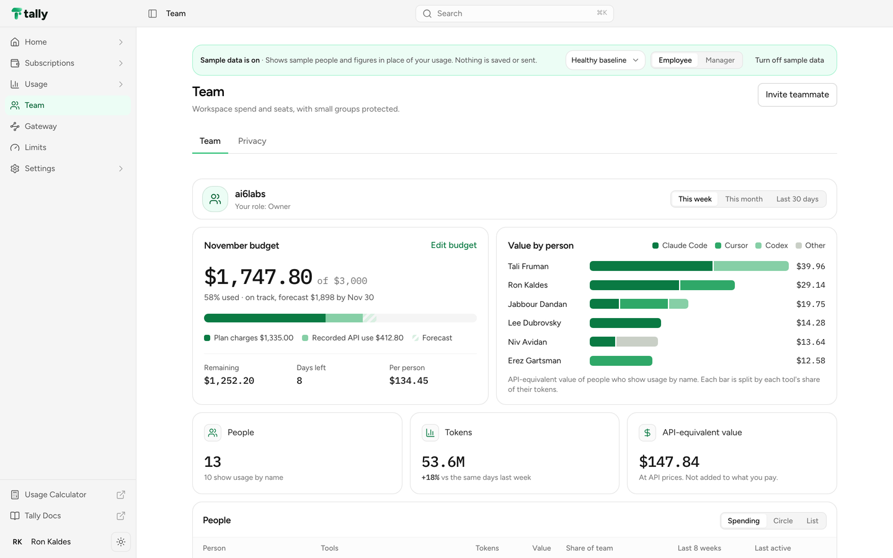
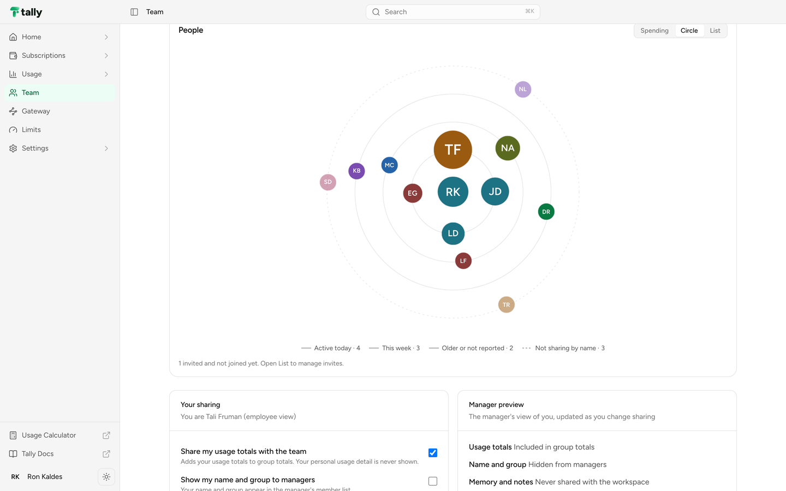
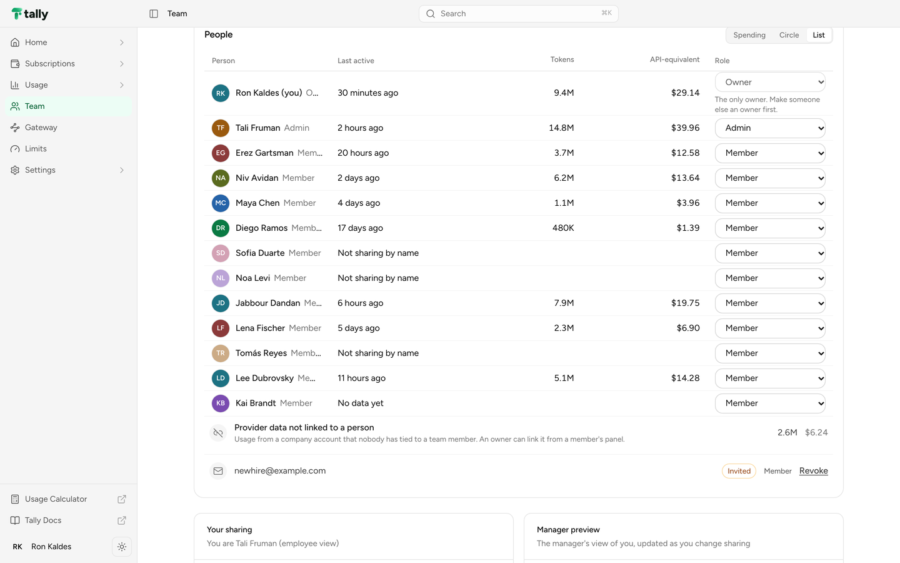
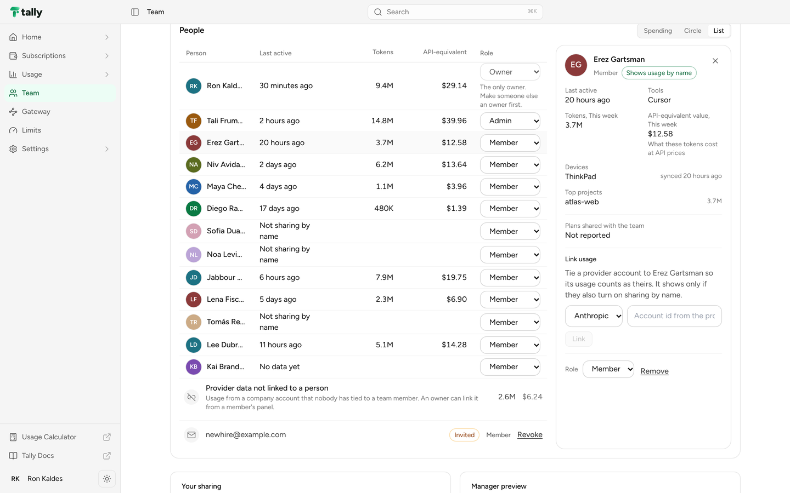

Team is for people who manage AI tools for others. Without a team, **Team** opens the screen that creates one.

## Create a team and invite people

1. Choose **Team** in the sidebar.
2. Type the team's name. A square logo is optional.
3. Choose **Create team and continue**. You become the owner.
4. The next step asks you to invite people by email with a role. You can skip it. Later, owners and admins use **Invite people** on the Team page.

## Read the team's figures

Choose **This week**, **This month** or **Last 30 days**.

- **Budget** (Mac app): what the team spent this month against its budget, split into **Plan charges** and **Recorded API use**, what remains, the days left and the amount per person. Recorded API use is shown to owners and admins only, and the end-of-month forecast is left out when spend data is incomplete. Owners and admins set the budget with **Edit budget** in the Mac app; the web Team page does not have it.
- **Value by person:** up to six people who show usage by name and have reported usage, by API-equivalent value. Each bar is split by each tool's share of their tokens.
- **People**, **Tokens** and **API-equivalent value** for the period. API-equivalent value is what the tokens would cost at API prices, not what the team pays.

<Note>The Team spending view (budget and value by person) is newer than the 2.3.3 download. The pictures use sample data relabelled with ai6labs names.</Note>

<Frame></Frame>

## See the people

Under **People**, choose a view:

- **Spending:** tools, tokens, value, share of the team, the last 8 weeks and last active per person.
- **Circle:** people by how recently they were active; bigger means more usage.
- **List:** last active, tokens, value and role per person. Owners change roles here.

<Frame></Frame>

<Frame></Frame>

Click a person to open their panel: last active, tools, devices, top projects and, for owners, **Link usage** and the role.

<Frame></Frame>

## What you show the team

A person's numbers appear only after they turn on **Show my usage to this team by name**. For now only members can; owners and admins do not send their own usage by name. Everyone else shows as "Not sharing by name", with no numbers. Turning it off deletes what the team had of you.

While you are signed in, have **Sync usage** on and both team switches on, Tally sends your daily token counts per tool and model, and their value at API list prices. It never sends prompts, messages, project or folder names, or your computer's name.

The team's headline is the sum of what is shown by name plus company-account usage not linked to anyone.

## Import your organisation's usage

In the Mac app, open **Team** and choose **Import usage CSV**, then pick the usage CSV exported from your Anthropic console. Tally shows one row per person with requests, tokens, what the company was billed and the API-equivalent value. The file is read and kept on this Mac only.
